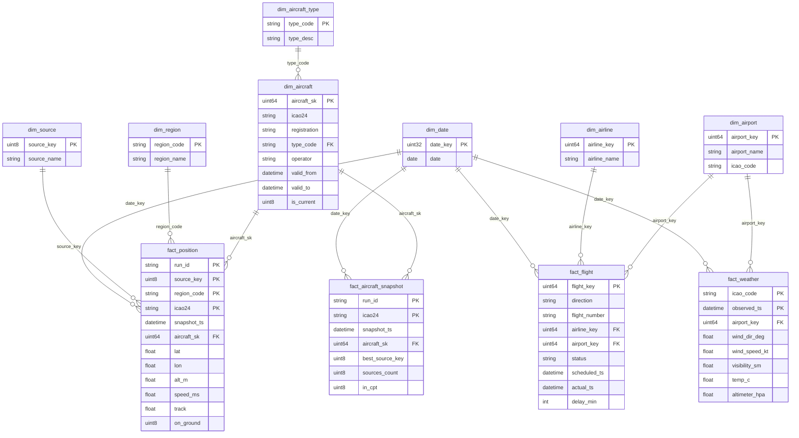

# ЛР2. Нормализация данных и Data Quality

Тема: анализ воздушного движения по открытым ADS-B данным, регион — Кейптаун (ЮАР).

Из сырого слоя ODS (ЛР1) строится слой детальных данных DDS: очистка, приведение типов,
обогащение, слияние источников, медленно меняющиеся измерения, зависимости между DAGами
и отдельный DAG проверки качества.

## 1. Где строится DDS

DDS лежит в **ClickHouse**, в той же базе `ods`, таблицы с префиксом `dds_`. Это согласуется
с выводом ЛР1: ClickHouse выбран основным хранилищем (см. «Вывод» в [REPORT.md](REPORT.md)),
позиции бортов — главный и самый быстрорастущий набор.

Что даёт ClickHouse и как решены его ограничения:

| Особенность | Как учтено |
|---|---|
| нет дешёвого `UPDATE` | SCD2 и дедупликация сделаны на `ReplacingMergeTree`: изменение записывается как вставка строки с тем же ключом и новым `row_version` |
| нет внешних ключей | целостность проверяется DAGом качества (проверки `*_in_dim`) |
| дубли схлопываются только при слиянии кусков | факты читаются с `FINAL` |
| нет суррогатных ключей-последовательностей | ключи детерминированные: `cityHash64` от естественного ключа, поэтому повторный запуск даёт те же ключи |

## 2. Структура хранилища

Выбрана **схема «созвездие» (несколько звёзд с общими измерениями)** с одной «снежинкой».

Звезда — это один факт, окружённый измерениями. У нас четыре разных процесса (позиции,
слитые позиции, рейсы, погода), поэтому четыре факта, которые делят общие измерения
(дата, аэропорт, источник). Снежинка — измерение, развёрнутое в несколько таблиц: самолёт
вынесен в `dim_aircraft` и `dim_aircraft_type`. Это сделано ради 3НФ: описание типа
(«BOEING 737-800») зависит от кода типа, а не от конкретного борта, и в одной таблице
оно бы дублировалось в каждой строке борта.

### Модель



Диаграмма написана в Mermaid и отображается прямо на GitHub. Для презентации модель
можно нарисовать в draw.io, dbdiagram.io или в ER-редакторе DBeaver (он строит диаграмму
по существующим таблицам).

### Таблицы

| Таблица | Тип | Грануляр­ность / ключ | Откуда |
|---|---|---|---|
| `dds_fact_position` | факт | позиция борта в снимке: (run_id, источник, регион, icao24) | `ods_positions` |
| `dds_fact_aircraft_snapshot` | факт (агрегат) | борт в снимке: (run_id, icao24), источники слиты | `dds_fact_position` |
| `dds_fact_flight` | факт | рейс: (дата, направление, номер, время по расписанию) | `ods_flights` |
| `dds_fact_weather` | факт | наблюдение: (станция, время) | `ods_metar` |
| `dds_dim_aircraft` | измерение, **SCD2** | версия атрибутов борта | `ods_positions.raw` |
| `dds_dim_aircraft_type` | измерение, SCD1 | код типа | `ods_positions.raw` |
| `dds_dim_airline` | измерение, SCD1 | авиакомпания | `ods_flights` |
| `dds_dim_airport` | измерение, SCD1 | аэропорт | `ods_flights`, справочник |
| `dds_dim_source` | измерение | источник ADS-B | справочник |
| `dds_dim_region` | измерение | регион опроса (cpt, za) | справочник |
| `dds_dim_date` | измерение | день | генерируется |
| `dds_dq_results` | служебная | результат проверки | DAG качества |

### Приведение к 3НФ

- Атрибуты авиакомпании, аэропорта, источника и региона не повторяются в фактах, факты хранят
  только ключи и измеряемые значения.
- Транзитивная зависимость «борт → тип → описание типа» разорвана выделением
  `dim_aircraft_type`.
- Составное направление «откуда / куда» в табло приведено к одному полю `airport_key`:
  для вылета это пункт назначения, для прилёта — пункт отправления, второй конец всегда
  Кейптаун. Направление хранится отдельно в `direction`.
- Время по расписанию и фактическое время хранятся как `DateTime` в UTC, а не строками
  «05:45» без даты. Фактическое время восстанавливается как расписание плюс задержка.
- Неизвестные значения не хранятся как NULL в ключах: для них есть строки-«неизвестно»
  (ключ 0 или пустой код), поэтому ссылка из факта всегда валидна.

## 3. Очистка, обогащение, агрегация

Вся логика в SQL-скриптах [sql/dds](sql/dds), Python только запускает их из Airflow.

**Очистка** (`30_fact_position.sql`, `50_fact_flight.sql`, `60_fact_weather.sql`):

| Что | Правило |
|---|---|
| дубли | позиции: одна на (снимок, источник, регион, борт); рейсы: последнее состояние из всех снимков табло; METAR: перекрывающиеся окна запросов схлопываются по (станция, время) |
| типы | время из строк в `DateTime` UTC, время табло из UTC+2 в UTC, видимость `6+` в число, `on_ground` в `UInt8` |
| пропуски | позиции без координат и с некорректным `icao24` отбрасываются |
| выбросы | высота вне −500…20 000 м, скорость вне 0…400 м/с, курс вне 0…360, ветер, температура и давление вне физического диапазона заменяются на NULL, сама запись остаётся |
| задержки | считаются только для вылетевших и севших рейсов, переход через полночь поправлен, задержка больше 4 часов считается ошибкой табло и остаётся NULL |

**Обогащение:** к позиции добавляется версия борта, актуальная на момент снимка
(регистрация, тип, оператор), к рейсу добавляются авиакомпания и аэропорт второго конца,
к погоде аэропорт по ICAO-коду станции.

**Слияние источников и агрегация** (`31_fact_aircraft_snapshot.sql`): один борт в одном
снимке виден разными сетями и двумя регионами. Все эти строки сворачиваются в одну:
координаты берутся у лучшего источника (adsb.lol, затем adsb.fi, затем OpenSky), считается
число сетей, видевших борт, и признак попадания в зону Кейптауна. Это основа для вопроса ЛР3
о покрытии источников.

## 4. Медленно меняющиеся измерения (SCD)

| Измерение | Тип | Почему |
|---|---|---|
| `dim_aircraft` | **SCD2** | регистрация, тип и оператор борта меняются (перекраска, лизинг, смена оператора); анализ за прошлый период должен видеть тогда актуальные значения |
| `dim_aircraft_type`, `dim_airline`, `dim_airport` | SCD1 | названия исправляются, история изменений не нужна |
| `dim_source`, `dim_region`, `dim_date` | статические | справочники |

Как устроен SCD2 в `20_dim_aircraft.sql`:

1. Наблюдения (борт, снимок) берутся только из adsb.lol и adsb.fi: OpenSky не отдаёт
   регистрацию и тип. Если оба источника видят борт, приоритет у непустого значения,
   затем у adsb.lol.
2. Оконной функцией `lagInFrame` ищутся моменты, когда атрибуты отличаются от предыдущего
   наблюдения. Каждый такой момент открывает новую версию.
3. `valid_to` версии равен `valid_from` следующей (`leadInFrame`), у последней он равен
   `2100-01-01`, и `is_current = 1`.
4. Первая версия открыта в прошлое (`valid_from = 1970-01-01`), чтобы факты, снятые
   до первого появления атрибутов, тоже нашли версию.
5. Ключ строки `(icao24, valid_from)` не меняется, поэтому повторный запуск заменяет строки
   (`ReplacingMergeTree` по `row_version`), а не дублирует.
6. Факт находит нужную версию через `ASOF LEFT JOIN` по `snapshot_ts >= valid_from`,
   в `aircraft_sk` ложится ключ версии, действовавшей в момент снимка.

Ограничения:

- История пересобирается из всего ODS целиком, а не инкрементально. На текущих объёмах
  это секунды, при росте ODS на порядки стоит перейти на инкремент.
- За неделю наблюдений атрибуты бортов не менялись, поэтому в данных пока 164 борта
  и 164 открытые версии. Работа механизма показана на синтетическом примере тем же SQL,
  см. `tools/scd2_demo.py` и раздел 8.

## 5. Зависимости между ETL-процессами

Детальный слой должен ждать загрузки исходных данных. Использованы два механизма:

1. **Assets Airflow 3** ([dags/datasets.py](dags/datasets.py)). DAGи ODS в конце публикуют
   asset (`ods_positions`, `ods_flights`, `ods_metar`), и DAGи DDS стартуют сами, когда asset
   обновлён. Публикует отдельная задача `publish`, которая зависит от всех трёх задач
   загрузки (по одной на хранилище), поэтому DDS не стартует, пока ClickHouse не дозагрузился.
2. **Сенсор** `ods_ready` (`PythonSensor`, режим `reschedule`) в начале каждого DAGа DDS.
   Он проверяет, что таблица ODS существует и непуста. Это защита для ручного запуска,
   когда asset никто не публиковал.

```
ods_positions ─► [asset] ─► dds_positions ─┐
ods_board     ─► [asset] ─► dds_flights   ─┼─► [assets] ─► dds_quality
ods_weather   ─► [asset] ─► dds_weather   ─┘
ods_archive   ─► все три asset
```

| DAG | Запускается по | Задачи |
|---|---|---|
| `dds_positions` | asset `ods_positions` | ods_ready → schema → dim_aircraft → fact_position → fact_aircraft_snapshot → publish |
| `dds_flights` | asset `ods_flights` | ods_ready → schema → dim_airline_airport → fact_flight → publish |
| `dds_weather` | asset `ods_metar` | ods_ready → schema → fact_weather → publish |
| `dds_quality` | все три DDS-asset | четыре параллельные задачи `check` → verdict |

В DAGи ODS внесено минимальное изменение: задача `publish` и объявление asset. Логика
загрузки не менялась.

## 6. Data Quality

DAG `dds_quality` запускается, когда обновились все три потока DDS. Проверки лежат
в [dags/dq.py](dags/dq.py), каждая это SQL с одним числом и правило «не больше / не меньше
порога». Результат пишется в `dds_dq_results`. Проверка уровня `error` валит DAG,
`warn` только помечается.

| Область | Проверки |
|---|---|
| `positions` | объём ODS и DDS (доля сохранённых не ниже 0.9), слитый факт покрывает все позиции, дубли, координаты, высота, скорость, длина icao24; предупреждения: доля пустых позывных и доля бортов с неизвестными атрибутами |
| `flights` | объём ODS и DDS (не ниже 0.99), дубли, пустой номер рейса, задержка вне ±240 мин; предупреждения: неизвестная авиакомпания и аэропорт |
| `weather` | объём, дубли, ветер, температура, давление; предупреждение: станция не найдена в справочнике |
| `integrity` | ссылки фактов на измерения (источник, регион, дата, борт, авиакомпания, аэропорт), тип борта есть в справочнике типов, SCD2: у каждого борта ровно одна текущая версия и версии идут встык |

Просмотр истории проверок:

```sql
select run_ts, area, check_name, status, value, rule
from dds_dq_results order by run_ts desc, area limit 50
```

## 7. Как воспроизвести

```bash
docker compose up -d
# разовая загрузка собранного вручную в ODS (если data/raw есть)
docker compose exec airflow-scheduler airflow dags trigger ods_archive
```

После `ods_archive` три DAGа DDS стартуют сами по asset, а после них `dds_quality`.
Вручную:

```bash
docker compose exec airflow-scheduler airflow dags trigger dds_positions
docker compose exec airflow-scheduler airflow dags trigger dds_flights
docker compose exec airflow-scheduler airflow dags trigger dds_weather
docker compose exec airflow-scheduler airflow dags trigger dds_quality
```

Проверка результата:

```bash
docker compose exec clickhouse clickhouse-client -u ods --password ods -d ods -q \
  "select 'positions', count() from dds_fact_position final
   union all select 'snapshots', count() from dds_fact_aircraft_snapshot final
   union all select 'flights', count() from dds_fact_flight final
   union all select 'weather', count() from dds_fact_weather final
   union all select 'aircraft versions', count() from dds_dim_aircraft final"
```

Пример SCD2: борты, у которых больше одной версии:

```sql
select icao24, registration, type_code, operator, valid_from, valid_to, is_current
from dds_dim_aircraft final
where icao24 in (select icao24 from dds_dim_aircraft final group by icao24 having count() > 1)
order by icao24, valid_from
```

Пример запроса по факту с измерениями (средняя задержка по авиакомпаниям):

```sql
select a.airline_name, count() as flights, round(avg(f.delay_min), 1) as avg_delay
from (select * from dds_fact_flight final) as f
join (select * from dds_dim_airline final) as a on a.airline_key = f.airline_key
where f.delay_min is not null
group by a.airline_name order by avg_delay desc
```

## 8. Результаты запуска

Прогон 16.10.2026 на данных, собранных с 27.09 по 02.10: 3627 позиций, 3437 записей табло
и 398 сводок METAR в ODS.

### Запуск DAGов

Восемь DAGов разобраны без ошибок, четыре из них относятся к DDS:

```
$ docker compose exec airflow-scheduler airflow dags list

dds_flights   | /opt/airflow/dags/dds_flights_dag.py   | airflow | False
dds_positions | /opt/airflow/dags/dds_positions_dag.py | airflow | False
dds_quality   | /opt/airflow/dags/dds_quality_dag.py   | airflow | False
dds_weather   | /opt/airflow/dags/dds_weather_dag.py   | airflow | False
ods_archive   | /opt/airflow/dags/archive_dag.py       | airflow | False
ods_board     | /opt/airflow/dags/board_dag.py         | airflow | False
ods_positions | /opt/airflow/dags/positions_dag.py     | airflow | False
ods_weather   | /opt/airflow/dags/weather_dag.py       | airflow | False
```

Задачи `dds_positions`, включая сенсор ожидания ODS:

```
task_id                  state
ods_ready                success
schema                   success
dim_aircraft             success
fact_position            success
fact_aircraft_snapshot   success
publish                  success
```

Зависимости через assets работают: `dds_quality` никто не запускал руками, он стартовал сам
после того, как все три DAGа DDS опубликовали свои assets. Это видно по идентификатору
запуска:

```
run_id: asset_triggered__2026-10-16T19:44:13.000895+00:00_tzwJzN91
state:  success
```

### Наполнение DDS

| Таблица | Строк | Что внутри |
|---|---|---|
| `dds_fact_position` | 3627 | очищенные позиции, по одной на снимок, источник, регион и борт |
| `dds_fact_aircraft_snapshot` | 1753 | борт в снимке после слияния трёх источников |
| `dds_fact_flight` | 1599 | рейсы, последнее состояние каждого |
| `dds_fact_weather` | 241 | наблюдения METAR |
| `dds_dim_aircraft` | 164 | версии бортов (SCD2) |
| `dds_dim_aircraft_type` | 66 | типы самолётов |
| `dds_dim_airline` | 29 | авиакомпании |
| `dds_dim_airport` | 42 | аэропорты |
| `dds_dim_date` | 1500 | календарь |
| `dds_dq_results` | 33 | результаты последнего прогона проверок |

### Что дала трансформация

| Поток | В ODS | В DDS | Что произошло |
|---|---|---|---|
| Рейсы | 3437 | 1599 | схлопнуты повторные снимки табло: один рейс встречался в среднем в двух снимках |
| Погода | 398 | 241 | убрано перекрытие: каждый запрос METAR берёт 12 часов истории |
| Позиции | 3627 | 3627 | дублей и битых значений не нашлось |

Про позиции стоит сказать прямо: проверка ODS показала ноль записей без координат, ноль
неверных `icao24`, ноль значений высоты и скорости вне физического диапазона и ноль дублей
внутри снимка. Чистка в `30_fact_position.sql` отработала вхолостую, но осталась: источники
волонтёрские, и отсутствие мусора в недельной выборке не гарантирует его отсутствия дальше.
Проверки качества следят за этим постоянно.

### Качество данных

Все 33 проверки последнего прогона пройдены:

| Область | Проверок | Провалено | Худшее значение |
|---|---|---|---|
| `positions` | 9 | 0 | доля пустых позывных 4.7% при пороге 50% |
| `flights` | 6 | 0 | доля неизвестных авиакомпаний 0% при пороге 5% |
| `weather` | 6 | 0 | все нули |
| `integrity` | 12 | 0 | все ссылки фактов на измерения разрешаются |

Проверки объёма `rows_ods_vs_dds` по всем трём потокам дали 1.0: ни одной записи
не потеряно при переносе.

### SCD2

За неделю наблюдений атрибуты бортов не менялись, поэтому в `dds_dim_aircraft` 164 борта
и 164 открытые версии, ни одной закрытой. Чтобы показать, что механизм действительно
работает, а не просто объявлен, есть скрипт `tools/scd2_demo.py`: он берёт **тот же самый**
SQL из `sql/dds/20_dim_aircraft.sql`, подменяет имена таблиц на временные и прогоняет его
на борте, у которого между снимками сменились регистрация и оператор.

```
$ docker compose exec airflow-scheduler python /opt/project/tools/scd2_demo.py

Снимков на входе: 3, из них с изменением атрибутов: 1

регистрация  оператор       действует с           действует по          текущая
ZS-AAA       Old Operator   1970-01-01 00:00:00   2026-10-03 09:00:00   0
ZS-BBB       New Operator   2026-10-03 09:00:00   2100-01-01 00:00:00   1

Версий: 2, закрытых: 1, текущих: 1
```

Прошлая версия закрылась моментом изменения, новая открылась тем же моментом и помечена
текущей. Разрывов и перекрытий нет, что отдельно проверяется в области `integrity`.

### Проверка осмысленности данных

Витрина должна воспроизводить результаты, полученные раньше напрямую по сырым файлам.
Запрос к факту через измерение авиакомпаний:

```sql
select a.airline_name, count() as flights, round(avg(f.delay_min), 1) as avg_delay
from (select * from dds_fact_flight final) as f
join (select * from dds_dim_airline final) as a on a.airline_key = f.airline_key
where f.direction = 'departures' and f.delay_min is not null
group by a.airline_name having flights >= 15 order by avg_delay desc
```

| Авиакомпания | Вылетов | Средняя задержка, мин |
|---|---|---|
| CemAir | 49 | 28.2 |
| Global Aviation | 62 | 14.7 |
| Airlink | 146 | 12.3 |
| FlySafair | 268 | 5.8 |
| South African Airways | 60 | 4.4 |

Числа совпадают с первичным анализом из ЛР1, который считался напрямую по JSON-файлам
(раздел 4 отчёта ЛР1). Это независимая проверка того, что нормализация, перевод времени
в UTC и расчёт задержек не исказили данные.

### Найденные и исправленные дефекты

1. **Задвоение статических измерений.** Три DAGа DDS стартуют одновременно по assets,
   и каждый вызывает `ensure_schema`. Проверка «такой строки ещё нет» не спасает от гонки:
   в `dds_dim_date` оказалось 3000 строк на 1500 дат. Исправлено в `dags/dds.py` —
   после наполнения справочников выполняется `optimize table ... final`, дубли схлопываются.
   На чтение это не влияло (везде используется `FINAL`), но таблицы росли при каждом прогоне.
2. **Недоказуемый SCD2.** Описан выше: добавлен `tools/scd2_demo.py`.

Проверено дополнительно, что слияние трёх источников в `dds_fact_aircraft_snapshot`
не теряет значения: ни одной высоты или скорости, которая есть у соседнего источника,
но потерялась при выборе приоритетного.
